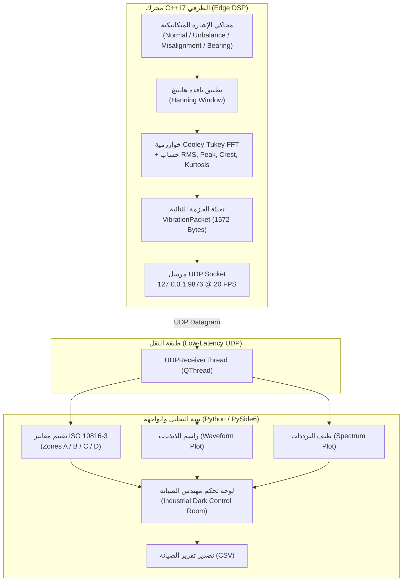

# ⚡ MechPulse | نظام الرصد الاهتزازي والتنبؤ بالأعطال الصناعي

<div align="center">

```text
    __  ___          __    ____        __          
   /  |/  /__  _____/ /_  / __ \__  __/ /________  
  / /|_/ / _ \/ ___/ __ \/ /_/ / / / / / ___/ _ \ 
 / /  / /  __/ /__/ / / / ____/ /_/ / (__  )  __/ 
/_/  /_/\___/\___/_/ /_/_/    \__,_/_/____/\___/  
```

**Real-Time Vibration Monitoring & Predictive Maintenance System**  
*Compliant with ISO 10816-3 / ISO 20816-3 Standards | Industry 4.0 Architecture*

[](https://github.com/mechpulse/mechpulse/actions)
[](https://github.com/)
[](https://www.iso.org/)
[](https://pypi.org/project/PySide6/)
[](LICENSE)
[](docs/architecture.md)

[English](#english-overview) • [العربية](#arabic-overview) • [Architecture](docs/architecture.md) • [Changelog](CHANGELOG.md)

</div>

---

<a name="arabic-overview"></a>
## 🇩🇿 نبذة عن المشروع (Overview)

**MechPulse (نبض الآلات)** هو نظام صناعي متكامل للرصد اللحظي للاهتزازات الميكانيكية والتنبؤ المبكر بأعطال الآلات الدوارة (المضخات، التوربينات، الضواغط والمحركات الكهربائية) وفق المعايير القياسية العالمية **ISO 10816-3 / ISO 20816-3**.

صُمم النظام لتلبية متطلبات المنشآت والمجمعات الصناعية الكبرى في الجزائر (مثل مجمعات سوناطراك، محطات ضخ المياه والمحروقات، ومصانع الإسمنت والصلب)، حيث يجمع بين:
- **محرك معالجة طرفية فائق السرعة بلغة C++17 (Edge DSP)** لحساب تحويل فورييه السريع (FFT) واستخراج المؤشرات الإحصائية بزمن تأخير شبه معدوم.
- **واجهة تحكم وتحليل ذكية بلغة Python (PySide6 & PyQtGraph)** مخصصة لغرف التحكم ومهندسي الصيانة مع تقييم آلي لصحة الآلة وسجل تنبيهات لحظي.
- **محاكي توأم رقمي (Digital Twin)** لمحاكاة أعطال اختلال التوازن (Unbalance)، عدم المحاذاة (Misalignment)، وعيوب محامل الكريات (Bearing BPFO).

---

## 🌟 المميزات التقنية (Core Capabilities)

### 1. محرك المعالجة الرقمية الطرفي (C++ Edge DSP Engine)
- **نافذة هانينغ (Hanning Window):** معالجة الإشارة الرقمية لمنع التسرب الطيفي (Spectral Leakage).
- **خوارزمية Cooley-Tukey Radix-2 FFT:** تحويل فورييه السريع المدمج دون الحاجة لمكتبات خارجية معقدة.
- **مؤشرات إحصائية لحظية:** حساب السرعة الاهتزازية الفعالة (RMS Velocity)، أقصى تسارع (Peak Accel)، عامل القمة (Crest Factor)، ومعامل التفرطح (Kurtosis).
- **بروتوكول UDP ثنائي فائق السرعة:** إرسال حزم مدمجة بحجم **1572 بايت** بتردد 20 إطاراً في الثانية (20 FPS).

### 2. محاكاة فيزيائية واقعية للأعطال (Mechanical Fault Models)
- **Normal Operation:** حالة طبيعية ممتازة (Zone A/B).
- **Unbalance (1X):** اختلال توازن كتلوي في الدوار (تردد أساسي 25Hz لسرعة 1500 RPM).
- **Misalignment (2X):** عدم محاذاة المحاور والوصلات (توافقيات 50Hz و 75Hz).
- **Bearing Defect (BPFO):** تآكل المحامل ونبضات صدمية متكررة عند 120Hz مع ارتفاع عامل القمة و Kurtosis > 4.5.

### 3. واجهة مهندس الصيانة (Industrial Dark Dashboard)
- راسم إشارة المجال الزمني (Waveform Oscilloscope).
- طيف الترددات (FFT Spectrum) مع خطوط دلالية للترددات الحرجة.
- تصنيف آلي وفوري وفق مناطق ISO 10816 (Zone A, B, C, D).
- تشخيص ذكي مع توصيات فنية باللغتين العربية والإنجليزية.
- تصدير تقارير الصيانة بصيغة CSV.

---

## 📐 معمارية النظام (System Architecture)



---

## 📊 معايير شدة الاهتزاز (ISO 10816-3 Standards)

تقييم سرعة الاهتزاز الفعالة (RMS Velocity mm/s) للآلات الصناعية متوسطة الحجم (15kW - 300kW) ذات القواعد الصلبة:

| المنطقة الاهتزازية | النطاق (mm/s RMS) | الحالة الفنية (Machine Health) | الإجراء الهندسي الموصى به |
| :---: | :---: | :---: | :--- |
| **Zone A** | $0.0 \sim 1.4$ | 🟢 **ممتازة (Good / New)** | حالة مثالية؛ استمرار التشغيل الروتيني. |
| **Zone B** | $1.4 \sim 2.8$ | 🔵 **مقبولة (Acceptable)** | تشغيل مستمر طويل الأمد غير مقيد. |
| **Zone C** | $2.8 \sim 4.5$ | 🟠 **تحذير (Unsatisfactory)** | بداية اختلال توازن أو تآكل؛ جدولة صيانة وقائية. |
| **Zone D** | $> 4.5$ | 🔴 **خطر حرج (Critical Danger)** | إيقاف فوري للآلة لتجنب الانهيار الكارثي! |

---

## 📂 بنية المستودع (Repository Structure)

```text
mechpulse/
├── .github/                      # أتمتة CI/CD وقوالب GitHub
│   ├── workflows/ci.yml          # GitHub Actions Test & Lint Matrix
│   ├── ISSUE_TEMPLATE/           # قوالب الإبلاغ عن المشاكل واقتراح الميزات
│   └── PULL_REQUEST_TEMPLATE.md  # قالب مراجعة التغييرات
│
├── core-engine/                  # محرك C++17 للمعالجة اللحظية
│   ├── CMakeLists.txt            # إعدادات البناء القياسية
│   ├── include/
│   │   ├── PacketDef.hpp         # هيكل الحزمة الثنائية المشتركة (1572B)
│   │   ├── DSPProcessor.hpp      # واجهة خوارزميات FFT و Hanning و RMS
│   │   └── SignalGenerator.hpp   # محاكي الأعطال الميكانيكية
│   └── src/
│       ├── DSPProcessor.cpp
│       ├── SignalGenerator.cpp
│       └── main.cpp
│
├── src/mechpulse/                # حزمة بايثون البرمجية المهيكلة (PEP 517/518)
│   ├── __init__.py
│   ├── __main__.py               # نقطة تشغيل python -m mechpulse
│   ├── core/
│   │   ├── iso_evaluator.py      # محرك تقييم ISO 10816-3
│   │   ├── receiver.py           # مستقبل الحزم اللحظية UDP
│   │   └── simulator.py          # المحاكي التوأم الرقمي
│   └── ui/
│       ├── app.py                # نقطة تشغيل التطبيق
│       ├── theme.py              # السمة الصناعية الداكنة
│       ├── main_window.py        # النافذة الرئيسية
│       └── widgets/              # مكونات واجهة المستخدم المستقلة
│           ├── kpi_card.py       # بطاقات القياسات اللحظية
│           ├── waveform_plot.py  # راسم الذبذبات الزمني
│           ├── spectrum_plot.py  # طيف الترددات والقمم التوافقية
│           └── event_log.py      # جدول وسجل الأحداث
│
├── tests/                        # اختبارات الوحدة الآلية (Pytest)
│   ├── test_iso_evaluator.py     # فحص دقة تصنيف ISO
│   ├── test_packet.py            # التحقق من مقاس وتماسك الحزمة
│   └── test_simulator.py         # اختبار إشارات الأعطال
│
├── docs/                         # التوثيق المعماري والهندسي
│   └── architecture.md
├── config/                       # الإعدادات القابلة للتخصيص
│   └── default.yaml
├── pyproject.toml                # مواصفات الحزمة والاعتماديات
├── Makefile                      # أوامر البناء والاختبار السريعة
├── run_demo.bat                  # تشغيل فوري بضغطة زر واحدة
├── CHANGELOG.md                  # سجل التحديثات والإصدارات
├── CONTRIBUTING.md               # دليل المساهمة في المشروع
├── CODE_OF_CONDUCT.md            # قواعد السلوك المجتمعي
├── SECURITY.md                   # سياسة الأمان والإبلاغ
└── LICENSE                       # رخصة MIT مفتوحة المصدر
```

---

## 🚀 التشغيل السريع (Quick Start)

### 1. التثبيت (Installation)
تأكد من وجود Python 3.10+ ثم ثبّت الحزمة محلياً:
```bash
# تثبيت الحزمة
pip install -e .

# أو تثبيت أدوات التطوير والاختبار
pip install -e ".[dev]"
```

### 2. التشغيل بضغطة زر واحدة (Windows One-Click)
انقر نقراً مزدوجاً على **`run_demo.bat`**، أو نفّذ الأمر التالي:
```powershell
python -m mechpulse --simulate
```

### 3. تشغيل الاختبارات الآلية (Running Tests)
```bash
pytest tests/ -v
```

### 4. بناء وتشغيل محرك C++17 (اختياري)
إذا كان لديك مترجم C++ و CMake:
```bash
cd core-engine
mkdir build && cd build
cmake ..
cmake --build . --config Release
./MechPulseEngine
```
ثم شغل واجهة المراقبة:
```bash
python -m mechpulse
```

---

## 📤 نشر المستودع على GitHub (Push to GitHub)

المستودع المحلي مهيأ بالكامل ومحدث. لربطه بحسابك على GitHub ورفعه:

1. أنشئ مستودعاً جديداً باسم **`mechpulse`** على [GitHub.com](https://github.com/new).
2. نفّذ الأوامر التالية من سطر الأوامر داخل هذا المجلد:

```bash
# ربط المستودع البعيد (استبدل YOUR_USERNAME باسم حسابك)
git remote add origin https://github.com/YOUR_USERNAME/mechpulse.git

# رفع التحديثات إلى الفرع الرئيسي
git push -u origin main
```

---

## 📄 الترخيص (License)
هذا المشروع مرخص تحت رخصة **[MIT License](LICENSE)**.
نظام متاح ومفتوح للمهندسين والمطورين في قطاع الصناعة والتحكم الآلي.
