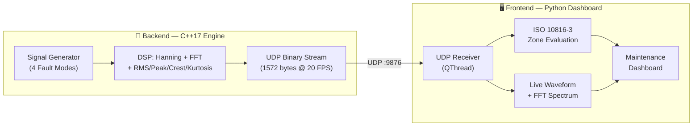

# ⚡ MechPulse — نظام الرصد الاهتزازي والتنبؤ بالأعطال الصناعي

<div align="center">

```
    ___  ___          _     ______      _          
    |  \/  |         | |    | ___ \    | |         
    | .  . | ___  ___| |__  | |_/ /   _| |___  ___ 
    | |\/| |/ _ \/ __| '_ \ |  __/ | | | / __|/ _ \
    | |  | |  __/ (__| | | || |  | |_| | \__ \  __/
    \_|  |_/\___|\___|_| |_|\_|   \__,_|_|___/\___|
```

**Real-Time Vibration Monitoring & Predictive Maintenance System**  
*ISO 10816-3 Compliant | Industry 4.0 | C++17 Edge DSP + Python Dashboard*

[](#backend)
[](#frontend)
[](#iso-10816-3)
[](LICENSE)

</div>

---

## 🏭 About | نبذة عن المشروع

**MechPulse (نبض الآلات)** is a real-time industrial vibration monitoring and predictive maintenance system designed for rotating machinery in Algerian industrial plants (Sonatrach, cement factories, pumping stations, power generation). It combines a **high-speed C++17 edge DSP engine** with a **Python PySide6 dashboard** compliant with **ISO 10816-3** standards.

---

## 📂 Project Structure | بنية المشروع

```
mechpulse/
│
├── backend/                 ← C++ Engine (Signal Processing & UDP Streaming)
│   ├── engine.cpp           # Complete DSP engine: FFT, Hanning, Signal Generator, UDP
│   └── CMakeLists.txt       # CMake build configuration
│
├── frontend/                ← Python Dashboard (UI & ISO Evaluation)
│   ├── app.py               # Complete dashboard: receiver, plots, ISO 10816, diagnostics
│   └── requirements.txt     # Python dependencies
│
├── README.md                ← This file
├── LICENSE                  ← MIT License
├── .gitignore               ← Git ignore rules
└── run_demo.bat             ← One-click Windows launcher
```

---

## ⚙️ Architecture | المعمارية



| Component | Language | Role |
|-----------|----------|------|
| **Backend** (`engine.cpp`) | C++17 | Signal simulation, Hanning window, Cooley-Tukey FFT, RMS/Peak/Crest/Kurtosis calculation, UDP binary streaming |
| **Frontend** (`app.py`) | Python 3.10+ | UDP receiver, ISO 10816-3 evaluation, PySide6 real-time dashboard, fault diagnosis, CSV export |

---

## 🔬 Simulated Fault Types | أنواع الأعطال المحاكاة

| # | Fault Type | Frequency Signature | RMS Level |
|---|-----------|---------------------|-----------|
| 0 | **Normal** (سليمة) | Low 1X fundamental | < 1.4 mm/s (Zone A) |
| 1 | **Unbalance** (اختلال توازن) | Dominant 1X peak at 25Hz | ~3.5 mm/s (Zone C) |
| 2 | **Misalignment** (عدم محاذاة) | Strong 2X (50Hz) + 3X (75Hz) | ~3.8 mm/s (Zone C) |
| 3 | **Bearing Defect** (عيب محمل) | BPFO impulses at 120Hz, high Crest Factor | Variable (Zone C/D) |

---

## 📊 ISO 10816-3 Vibration Severity | معايير شدة الاهتزاز

| Zone | RMS Velocity | Status | Action |
|:---:|:---:|:---:|:---|
| **A** | 0 — 1.4 mm/s | 🟢 Excellent | Routine monitoring |
| **B** | 1.4 — 2.8 mm/s | 🔵 Acceptable | Unrestricted operation |
| **C** | 2.8 — 4.5 mm/s | 🟠 Warning | Schedule maintenance |
| **D** | > 4.5 mm/s | 🔴 **DANGER** | **Immediate shutdown!** |

---

## 🚀 Quick Start | التشغيل السريع

### Option 1: One-Click Demo (Windows)
Double-click **`run_demo.bat`** — launches the dashboard with the built-in Python simulator.

### Option 2: Command Line
```bash
# Install dependencies
pip install -r frontend/requirements.txt

# Run with built-in simulator (no C++ needed)
python frontend/app.py --simulate
```

### Option 3: With C++ Backend
```bash
# Build C++ engine
cd backend
mkdir build && cd build
cmake .. && cmake --build . --config Release
./MechPulseEngine       # Terminal 1: starts streaming

# Run Python dashboard
python frontend/app.py  # Terminal 2: receives & displays
```

---

## 📄 License
[MIT License](LICENSE) — Open source for industrial engineers and developers.
