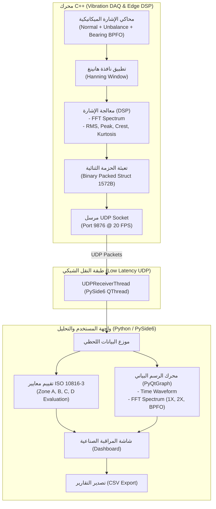

# 🏭 VibrationGuard AI | نظام الرصد الاهتزازي والتنبؤ بالأعطال

[](https://github.com/)
[](https://www.iso.org/)
[](https://pypi.org/project/PySide6/)
[](LICENSE)
[](README.md)

نظام صناعي متكامل للرصد اللحظي للاهتزازات الميكانيكية والتنبؤ بأعطال الآلات الدوارة (المضخات، التوربينات، الضواغط، والمحركات الكهربائية) وفق المعايير القياسية العالمية **ISO 10816-3 / ISO 20816-3**، موجه خصيصاً للمنشآت والمجمعات الصناعية في الجزائر (سوناطراك، مصانع الإسمنت، محطات الضخ، وتوليد الطاقة).

---

## 🌟 المميزات الرئيسية (Key Features)

1. **محرك معالجة رقمية عالي السرعة (High-Speed C++ Edge DSP):**
   - استهلاك منخفض جداً للموارد وزمن استجابة فائق الصغر (Zero Latency).
   - تطبيق نافذة هانينغ (Hanning Windowing) لمنع التسرب الطيفي (Spectral Leakage).
   - خوارزمية مدمجة لتحويل فورييه السريع (Radix-2 Cooley-Tukey FFT).
   - حساب فوري للمؤشرات الإحصائية الحرجة: RMS Velocity, Peak Acceleration, Crest Factor, Kurtosis.

2. **محاكاة متقدمة للأعطال الميكانيكية (Realistic Mechanical Fault Twin):**
   - **Normal State:** تشغيل سليم (Zone A/B).
   - **Unbalance (1X):** اختلال توازن الدوار عند تردد الدوران الأساسي 25Hz (1500 RPM).
   - **Misalignment (2X):** عدم محاذاة المحاور والوصلات (Coupling Misalignment 50Hz).
   - **Bearing Fault (BPFO):** تلف وتآكل محمل الكريات مع قمم صدمية بتردد 120Hz وارتفاع عامل القمة (Crest Factor).

3. **لوحة تحكم مهندس الصيانة (PySide6 & PyQtGraph UI):**
   - رسم بياني فائق السرعة ومستمر لراسم الذبذبات اللحظي (Oscilloscope).
   - طيف الترددات (FFT Spectrum) مع خطوط دلالية للترددات الحرجة.
   - تصنيف آلي وفوري لشدة الاهتزاز وفق ISO 10816 (مناطق A, B, C, D).
   - سجل إنذار لحظي وتصدير تقارير الصيانة بصيغة CSV.

---

## 📐 معمارية النظام (System Architecture)



---

## 📊 جدول تقييم شدة الاهتزاز (ISO 10816-3 Standard)

| المنطقة الاهتزازية | شدة الاهتزاز الفعالة (RMS Velocity) | حالة الآلة (Machine Health) | الإجراء الهندسي الموصى به |
| :---: | :---: | :---: | :--- |
| **Zone A** | $0.0 \sim 1.4\text{ mm/s}$ | **ممتازة (Good/New)** | تشغيل طبيعي ومثالي. |
| **Zone B** | $1.4 \sim 2.8\text{ mm/s}$ | **مقبولة (Acceptable)** | تشغيل مستمر دون قيود. |
| **Zone C** | $2.8 \sim 4.5\text{ mm/s}$ | **تحذير (Unsatisfactory)** | بداية تآكل أو اختلال توازن - جدولة صيانة وقائية. |
| **Zone D** | $> 4.5\text{ mm/s}$ | **خطر حرج (Critical/Danger)** | إيقاف فوري للآلة لتجنب الكوارث الميكانيكية! |

---

## 📂 بنية المشروع (Repository Structure)

```text
vibration-guard/
├── .gitignore               # ملف تجاهل الملفات لمستودع Git
├── LICENSE                  # رخصة MIT مفتوحة المصدر
├── README.md                # توثيق المشروع بالكامل
├── requirements.txt         # متطلبات مكتبات بايثون
├── run_demo.bat             # سكريبت لتشغيل العرض بضغطة زر واحدة
├── setup_git.bat            # سكريبت لتهيئة وربط المستودع بـ GitHub
│
├── core-engine/             # كود C++ الأساسي
│   ├── CMakeLists.txt       # إعدادات بناء CMake
│   ├── include/
│   │   ├── PacketDef.hpp    # هيكل الحزمة الثنائية المشتركة
│   │   ├── DSPProcessor.hpp # خوارزميات FFT و Hanning و RMS
│   │   └── SignalGenerator.hpp # محاكي الأعطال الميكانيكية
│   └── src/
│       ├── DSPProcessor.cpp
│       ├── SignalGenerator.cpp
│       └── main.cpp
│
└── ui-analytics/            # بيئة بايثون والواجهة
    ├── main.py              # نقطة تشغيل الواجهة
    ├── simulator_streamer.py# المحاكي التوأم الرقمي
    ├── receiver.py          # مستقبل حزم UDP اللحظية
    ├── iso_evaluator.py     # محرك تقييم ISO 10816
    └── gui/
        ├── main_window.py   # نافذة التحكم الرئيسية
        └── styles.py        # السمة الصناعية الداكنة
```

---

## 🚀 طريقة التشغيل السريعة (Quick Start)

### 1. تثبيت المتطلبات (Requirements)
تأكد من وجود Python 3.10+ ثم قم بتثبيت المتطلبات:
```bash
pip install -r requirements.txt
```

### 2. تشغيل العرض التوضيحي المباشر (One-Click Demo)
يمكنك النقر مرتين على ملف **`run_demo.bat`**، أو تنفيذ الأمر التالي من الطرفية:
```bash
python ui-analytics/main.py --simulate
```

### 3. بناء وتشغيل محرك C++ (اختياري)
إذا كان لديك مترجم C++ (مثل MinGW أو MSVC أو GCC) و CMake:
```bash
cd core-engine
mkdir build && cd build
cmake ..
cmake --build .
./vibration_engine
```
ثم قم بتشغيل الواجهة من الطرفية الأخرى:
```bash
python ui-analytics/main.py
```

---

## 📤 كيفية رفع المشروع إلى حسابك على GitHub

1. قم بإنشاء مستودع جديد فارغ على حسابك في GitHub وسمّه مثلاً: `vibration-guard`.
2. افتح الطرفية في هذا المجلد ونفّذ الأوامر التالية (أو شغّل `setup_git.bat`):
```bash
# 1. تهيئة المستودع
git init

# 2. إضافة جميع الملفات
git add .

# 3. حفظ أول Commit
git commit -m "feat: initial commit of VibrationGuard AI predictive maintenance system"

# 4. تعيين الفرع الرئيسي
git branch -M main

# 5. ربط المستودع بحسابك (استبدل الرابط برابط مستودعك)
git remote add origin https://github.com/YOUR_USERNAME/vibration-guard.git

# 6. الرفع إلى GitHub
git push -u origin main
```

---

## 👨‍💻 المساهمة والترخيص (License)
هذا المشروع مرخص تحت رخصة [MIT License](LICENSE).  
جاهز للتطوير والتطبيق في البيئات الصناعية.
