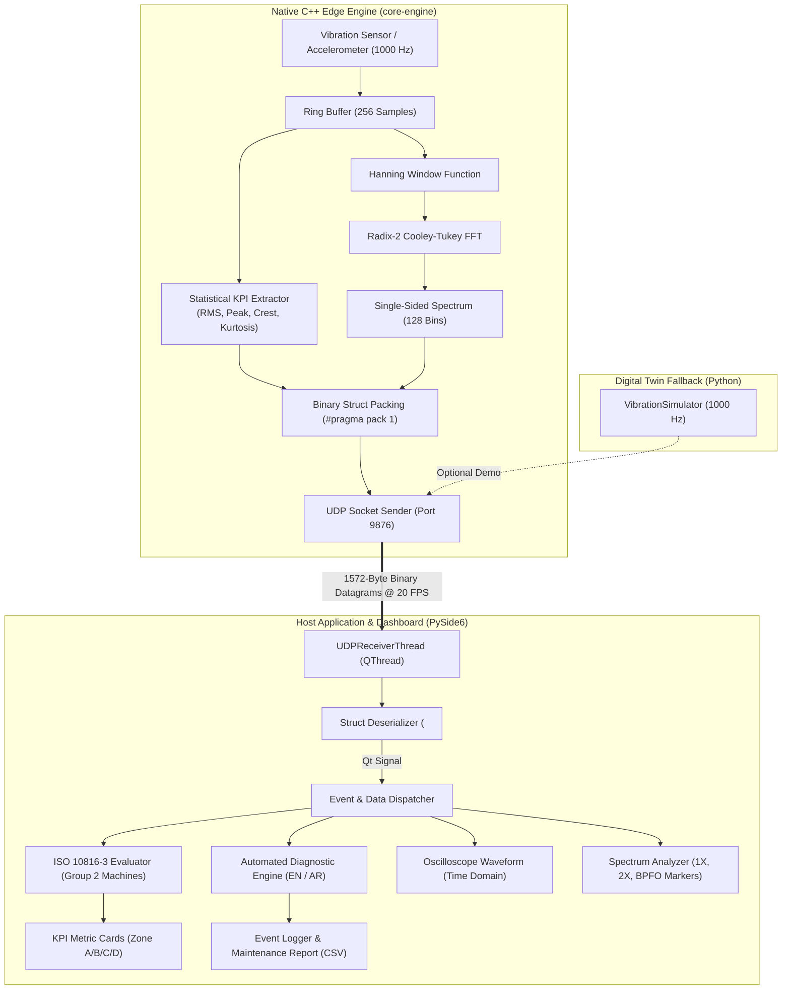

# MechPulse System Architecture & Technical Specifications

MechPulse is an industrial-grade vibration monitoring and predictive maintenance (PdM) platform designed for rotating machinery in Industry 4.0 environments. It integrates a high-performance native **C++ edge DSP engine** for ultra-low latency signal processing with a modular **Python / PySide6 / PyQtGraph** industrial dashboard for visualization and ISO 10816-3 condition assessment.

---

## 1. Architectural Overview

The MechPulse architecture decouples edge digital signal processing from human-machine interface (HMI) presentation via high-throughput, connectionless binary UDP telemetry.



---

## 2. Binary Packet Protocol (`VibrationPacket`)

To ensure real-time performance at 20 frames per second without JSON/protobuf serialization overhead, telemetry is streamed as a strictly packed C/C++ binary struct.

### 2.1 Packet Layout (Strictly 1572 Bytes)

Struct packing uses `#pragma pack(push, 1)` in C++ and `<d4f2Ii256f128f` in Python (Little-Endian, no compiler padding):

| Offset (Bytes) | Field Name | Data Type | Size (Bytes) | Description |
|:---:|:---|:---|:---:|:---|
| `0 - 7` | `timestamp` | `double` (float64) | 8 | Epoch timestamp in seconds |
| `8 - 11` | `rms_velocity` | `float` (float32) | 4 | Overall RMS vibration velocity in mm/s (per ISO 10816) |
| `12 - 15` | `peak_accel` | `float` (float32) | 4 | Peak acceleration amplitude ($g$) |
| `16 - 19` | `crest_factor` | `float` (float32) | 4 | Crest Factor: $\text{Peak} / \text{RMS}$ |
| `20 - 23` | `kurtosis` | `float` (float32) | 4 | 4th standardized statistical moment (bearing health) |
| `24 - 27` | `sample_rate` | `uint32_t` | 4 | Sampling frequency in Hz (typically 1000 Hz) |
| `28 - 31` | `sample_count` | `uint32_t` | 4 | Number of time-domain samples (256) |
| `32 - 35` | `fault_mode` | `int32_t` | 4 | Diagnostic code: 0=Normal, 1=Unbalance, 2=Misalignment, 3=Bearing Fault |
| `36 - 1059` | `samples[256]` | `float[256]` | 1024 | Raw time-domain waveform ($256 \times 4$ bytes) |
| `1060 - 1571`| `fft_spectrum[128]` | `float[128]` | 512 | Single-sided FFT magnitude bins ($128 \times 4$ bytes) |
| **Total** | | | **1572** | **Zero trailing padding bytes** |

---

## 3. Digital Signal Processing (DSP) Pipeline

The edge DSP pipeline processes streaming vibration data in discrete windows of $N = 256$ samples at a sampling frequency $F_s = 1000\text{ Hz}$.

### 3.1 Time-Domain Statistical Metrics

1. **Root Mean Square (RMS) Velocity ($v_{\text{rms}}$)**:
   $$v_{\text{rms}} = \sqrt{\frac{1}{N} \sum_{i=0}^{N-1} x[i]^2}$$
   Evaluated against ISO 10816-3 criteria to establish global mechanical vibration severity.

2. **Peak Value ($x_{\text{peak}}$)**:
   $$x_{\text{peak}} = \max_{i} |x[i]|$$

3. **Crest Factor ($CF$)**:
   $$CF = \frac{x_{\text{peak}}}{x_{\text{rms}}}$$
   Elevated crest factors indicate impulsive transient behavior typical of early-stage spalling or bearing race cracks.

4. **Kurtosis ($K$)**:
   $$K = \frac{\frac{1}{N}\sum_{i=0}^{N-1} (x[i] - \mu)^4}{\sigma^4}$$
   Normal healthy background Gaussian noise yields $K \approx 3.0$. Values above $4.5$ indicate repetitive mechanical impacts from roller element damage.

### 3.2 Spectral Analysis & Windowing

1. **Hanning Windowing**:
   To prevent spectral leakage from non-integer period truncation, raw blocks are multiplied by a periodic Hanning window:
   $$w[n] = 0.5 \left(1 - \cos\left(\frac{2\pi n}{N}\right)\right), \quad 0 \le n < N$$

2. **In-Place Radix-2 Cooley-Tukey FFT**:
   Transforms the windowed block $x_w[n]$ to complex frequency bins $X[k]$ with time complexity $\mathcal{O}(N \log_2 N)$.

3. **Magnitude Spectrum & Scaling**:
   Because the input signal is real-valued, only the non-redundant positive frequencies (bins $0 \le k < N/2 = 128$) are retained and normalized:
   $$A[k] = \frac{2}{N} |X[k]|, \quad \Delta f = \frac{F_s}{N} = \frac{1000}{256} \approx 3.90625\text{ Hz/bin}$$
   Frequency coverage spans $0\text{ Hz}$ to the Nyquist limit of $500\text{ Hz}$.

---

## 4. ISO 10816-3 Evaluation Standard

MechPulse implements real-time classification according to **ISO 10816-3: Mechanical vibration — Evaluation of machine vibration by measurements on non-rotating parts**.

The system defaults to **Group 2: Medium-sized machines (15 kW to 300 kW)** mounted on **rigid foundations**:

```
0.0 mm/s           1.4 mm/s           2.8 mm/s           4.5 mm/s           > 4.5 mm/s
   |------------------|------------------|------------------|------------------>
   [     Zone A       ]     Zone B       ]     Zone C       ]     Zone D       ]
       (Excellent)        (Acceptable)        (Warning)         (Danger)
```

| Severity Zone | RMS Velocity Range ($v_{\text{rms}}$) | Status Definition | Technical Recommendation | التوصية الفنية |
|:---:|:---:|:---|:---|:---|
| **Zone A** | $0.0 \le v_{\text{rms}} \le 1.4\text{ mm/s}$ | **Excellent** | Newly commissioned machinery; optimal dynamic balance. | حالة ممتازة: استمر في التشغيل الاعتيادي |
| **Zone B** | $1.4 < v_{\text{rms}} \le 2.8\text{ mm/s}$ | **Acceptable** | Machine is suitable for unrestricted long-term continuous operation. | حالة مقبولة: تشغيل مستقر دون قيود |
| **Zone C** | $2.8 < v_{\text{rms}} \le 4.5\text{ mm/s}$ | **Warning** | Machine condition is unsatisfactory for long-term continuous operation; plan corrective maintenance. | تحذير: اهتزاز مرتفع، يلزم جدولة صيانة وقائية |
| **Zone D** | $v_{\text{rms}} > 4.5\text{ mm/s}$ | **Critical Danger** | High vibration severity sufficient to initiate catastrophic failure; immediate shutdown mandatory. | خطر وشيك: إيقاف طارئ للمعدة لمنع الانهيار |

---

## 5. Automated Diagnostic Engine

The diagnostic module associates spectral harmonics with physical mechanical anomalies:

- **1X Running Speed Harmonics ($25\text{ Hz}$ at 1500 RPM)**:
  - Dominant 1X peak indicates **Dynamic Rotor Unbalance**.
- **2X Running Speed Harmonics ($50\text{ Hz}$)**:
  - Dominant 2X peak combined with phase shift indicates **Shaft Misalignment** or coupling wear.
- **Ball Pass Frequency Outer Race (BPFO $\approx 120\text{ Hz}$)**:
  - High kurtosis ($K > 4.5$) combined with high-frequency spectral markers indicates **Outer Race Bearing Flaws**.

---

## 6. Real-Time UI & Visualization Pipeline

- **Host Framework**: PySide6 (Qt for Python) with GPU-accelerated rendering through PyQtGraph.
- **Oscilloscope Waveform**: Displays live time-domain acceleration values ($256$ samples) with autoscale clipping prevention.
- **FFT Spectrum Analyzer**: 128-bin spectrum display with vertical dashed cursor indicators for $1X$, $2X$, and $\text{BPFO}$ spectral peaks.
- **Thread Safety**: Network reception and struct unpacking execute in a dedicated worker thread (`UDPReceiverThread`), communicating strictly via Qt Queued Connections (`Signal`/`Slot`) to guarantee 60 FPS smooth GUI responsiveness.
